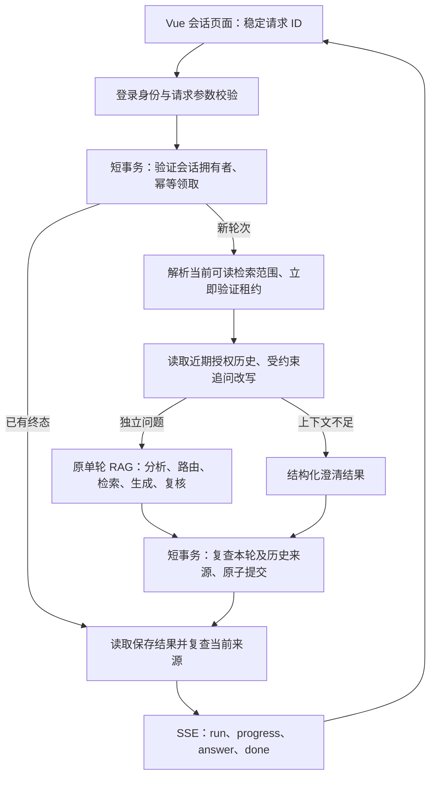
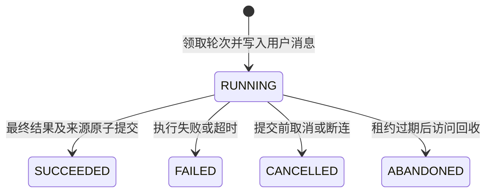

# 多轮 RAG 会话与回答持久化：实现说明与面试讲述

本方案对应本仓库已实现的首版功能：多轮追问、会话及回答持久化、请求幂等、当前权限复查、刷新与断线后的历史恢复。长会话摘要、自动接管重跑、模型 token 流和会话分享暂未实现。

## 1. 可以直接用于面试的讲述

### 一分钟版本

我把已有的单轮 RAG 链路扩展成了可恢复的多轮会话。每次提问先在 PostgreSQL 创建一条执行记录，客户端用稳定的请求 ID 防止断线重试重复生成。同一会话同时只允许一轮执行，数据库唯一约束和短事务负责兜底。

多轮上下文来自服务端保存、且当前仍有权限读取的最近几轮回答。模型只帮助消解“它”“第二条”等指代，后端校验替换位置及历史依据，保留用户原问题的其他条件，再用独立问题重新检索。历史回答不能替代本轮文档证据。

最后把完整结构化回答、引用来源和执行状态一起提交，再通过 SSE 发布核验后的段落。刷新页面时直接恢复已提交结果，不再调用模型。撤权、文档版本更新或来源删除后，历史回答会被隐藏。首版保留最近六轮上下文，长会话摘要留到后续。

### 三分钟版本

这次改造的难点是让多轮、幂等和权限同时成立。只把历史塞进 prompt，无法解决历史伪造、断线重试、跨用户会话访问和撤权后的答案泄露。

我在原有 Analyzer → Router → 混合检索 → 生成 → 复核链路外增加了 ChatService 和 ChatRepository。会话属于当前租户的具体成员；客户端只能传问题、资源选择和请求 ID，不能传历史、答案、租户或执行快照。

请求进入后锁定会话行，规范化问题与检索范围，计算 SHA-256。同一请求 ID、同一摘要返回原执行记录；不同摘要返回冲突；另一个请求正在运行也返回冲突。执行使用有期限的租约和周期心跳，数据库事务不会跨越模型调用。进程崩溃后，下一次历史访问会把过期执行标记为中断，释放会话。

追问改写只使用近期、仍可见且符合本次选择范围的回答。模型返回明确的替换区间和历史依据，代码根据原文重建问题；无依据的追问要求澄清。如果最近回答不可用，不会把“第二条”错误指向更早回答。改写得到独立问题后仍重新检索、生成和复核。

落库前再次校验本轮证据和实际使用的历史来源，并在一个事务中保存回答快照、助手消息、引用映射和成功状态。快照记录历史来源的传递依赖，所以后续回答即使换了新引用，也不能绕过旧来源撤权。历史读取和 SSE 发布也会复查当前权限与活动索引版本。

前端把流中的临时结果和服务器历史分开管理。已知执行 ID 时查询该轮，未知时先查历史；重试始终使用原请求 ID 和原请求体。浏览器只缓存按租户和用户隔离的当前会话 ID，回答从服务端恢复。实现验证覆盖了重复请求、并发限制、撤权、超时、取消、来源变化和断线恢复；真实模型质量仍需固定问题评测。

## 2. 首版范围与取舍

| 已实现 | 首版边界 |
| --- | --- |
| 创建、切换、分页加载个人会话 | 会话分享、归档和删除入口后续补充 |
| 追问指代消解与重新检索 | 最近最多六轮；无长会话摘要 |
| 持久化完整回答及原文引用 | 快照不是永久可读凭证，每次读取需复查来源 |
| 稳定请求 ID、同请求回放 | 同一会话一次只执行一轮 |
| 租约、心跳、超时与取消 | 过期轮次标记 ABANDONED，不自动接管重跑 |
| SSE 进度与核验后逐段发布 | 不发布模型草稿 token，不实现 Last-Event-ID 续传 |
| 刷新、断线、终态恢复 | 恢复数据库结果，不能保证供应商取消已发出的请求 |

首版优先保证可解释、可恢复和权限一致。上下文窗口有上限，但持久历史可分页浏览，历史展示范围与模型上下文范围是两件事。

## 3. 架构与完整链路



1. 使用当前登录身份校验会话的 `tenant_id + owner_member_id`，其他用户或租户访问统一返回 404。
2. 锁定会话行，处理过期轮次，检查稳定请求 ID 与请求摘要，再创建 RUNNING 轮次及 USER 消息。
3. 新请求解析当前检索范围。执行前立即确认租约有效，再开始历史读取与模型工作；期间定时续租。
4. 从服务端历史构造独立问题，实际使用的历史轮次单独记录依赖。
5. 复用已有单轮链路。用户原问题保存在 `question` 与 `plan.original_query`，检索使用独立问题 `plan.query`。
6. 完成事务验证租约、当前身份、本轮证据与历史来源，原子保存所有最终结果。
7. 完成提交后才发布回答；发布各段及最终完成事件前再次读取授权结果。
8. 重复请求和刷新从同一执行记录恢复，不再次调用改写、检索、生成或复核。

## 4. 数据模型为什么分成四张表

| 表 | 职责 | 关键字段与约束 |
| --- | --- | --- |
| `chat_session` | 会话拥有者和排序入口 | 租户、成员、标题、状态、最近活动时间 |
| `chat_run` | 一次请求的幂等记录与执行状态 | 请求 ID、请求摘要、原问题、独立问题、租约、JSONB 快照；租户+会话+请求 ID 唯一 |
| `chat_message` | 有顺序的 USER/ASSISTANT 消息 | 会话内 sequence 唯一；同轮同角色唯一 |
| `answer_citation` | 文档修订及原文来源映射 | 文档、修订、索引批次、分块、正文哈希、页码、章节 |

`chat_run.execution_snapshot` 使用 `schema_version=1`，保存规范化请求、完整 `QueryAnswerResponse`、实际使用的历史轮次和扁平化历史来源。完整响应包含分析、计划、范围、检索证据、陈述、引用及复核结果，刷新恢复无需重新拼装或生成。

USER 消息在领取事务中写入；ASSISTANT 消息在完成事务中写入，内容保存结构化响应 JSON。首版历史接口以执行记录及快照提供一致视图。引用表方便来源追溯，但不能仅用引用表是否有记录判断旧回答是否安全：文档清理可能删除引用映射，快照仍需按保存的来源信息复查。

## 5. 幂等、并发和租约

### 请求摘要

规范化后的摘要包含原问题、`client_request_id`、知识库选择和文档选择。选择列表按数字 ID 排序；省略与 null 等价。问题和范围变更会改变摘要。

| 情况 | 服务端行为 |
| --- | --- |
| 相同 ID + 相同摘要 + 已成功 | 返回保存结果，按当前权限决定回答是否可见 |
| 相同 ID + 相同摘要 + 仍执行 | 409 `CHAT_RUN_IN_PROGRESS`，客户端恢复状态 |
| 相同 ID + 不同摘要 | 409 `CHAT_IDEMPOTENCY_CONFLICT` |
| 不同 ID + 会话仍有活动轮次 | 409 `CHAT_RUN_ACTIVE` |
| 相同 ID + 失败/取消/中断终态 | 返回原终态；重新提问必须生成新 ID |

应用层锁定会话行，使领取、消息序号分配和完成提交按会话串行；数据库还有部分唯一索引 `uq_chat_one_active_run`，只对 PENDING/RUNNING 生效。锁不会持续到模型返回。

### 执行状态



兼容已有 PENDING 记录，超期也会回收为 ABANDONED。新请求直接创建 RUNNING。默认租期 90 秒，每三分之一租期续租一次；本轮总执行预算默认 120 秒。心跳、完成更新同时检查 `lease_owner + lease_epoch + 未过期`，失去租约不能提交。

首版没有租约接管，所以新轮次从 epoch=1 开始；epoch 检查为将来接管扩展保留。恢复策略是结束旧轮次并明确展示中断，由用户重新提问，避免自动重跑产生重复费用。

### 能保证什么，不能保证什么

可以保证：同一个已提交请求回放时不会重复生成；同会话不会正常领取两个活动执行；助手消息、引用、快照和成功状态同事务提交；失败不会覆盖已成功结果。

不能宣称供应商调用 exactly-once。模型可能已经处理请求，但进程在落库前崩溃；数据库与供应商之间没有分布式原子事务。旧轮次最终中断，用户用新 ID 重问仍可能再次计费。token 统计也是已收到有效响应的用量，不是账单凭证。

## 6. 多轮追问如何避免补出事实

上下文由后端读取，客户端没有 `history` 字段。只使用近期成功、可见、且本轮范围允许的回答。传给改写模型的历史答案仅包含已通过复核的陈述文本，不附带原文证据、内部执行快照或诊断信息。

改写模型返回结构化决策：保持原问、替换指代或要求澄清。替换必须包含原问题中的明确区间、历史轮次及陈述依据、来源中的逐字实体片段。代码根据替换位置重建问题，而不是直接接受模型写出的新问题。时间、数字、部门、文档类型等额外事实与限制不能借改写加入。

例子：

| 原问题 | 可用历史 | 行为 |
| --- | --- | --- |
| 它由谁确认？ | 最近回答明确讨论工单 | 校验后替换“它”为有依据的对象，再检索 |
| 第二条展开一下 | 最近回答有第二条陈述 | 依据对应陈述识别对象；不越级使用其他条目 |
| 第二条展开一下 | 最近回答已撤权或没有可用历史 | 保存澄清结果，要求补充对象和条件 |
| 工单如何创建？ | 任意历史 | 独立问题无需绑定旧来源 |

上下文最多六轮，改写 payload 另有 24,000 字节 UTF-8 预算。超限按整轮从最早历史开始移除，不截断陈述；明确追问缺少有效对象时澄清。改写超时、非法输出或依据校验失败，也不会把无依据的追问直接发给检索。

历史只是解析问题的线索。独立问题仍经过当前授权范围下的新检索，回答事实必须由本轮原文支持。改写后复查所用历史，完成事务再复查一次，避免等待期间的撤权。

## 7. 权限与历史恢复为什么必须一起设计

权限分为会话拥有权与资料读取权。拥有自己的会话，不代表可以永久阅读其中引用的文档。

仓储操作重新验证登录会话、租户和成员状态，并根据当前部门、密级、知识库授权和文档授权校验来源。来源还要匹配当前发布文档、活动索引批次、READY 状态、修订/分块 ID、存储的正文哈希和实际正文哈希。快照只能用于定位来源，不能替代实时授权。

来源包含两部分：本轮响应的全部检索证据，以及追问实际使用历史的传递来源。例如第三轮依赖第二轮的对象，而第二轮又来自第一轮文档 A，第三轮也记录 A 的来源。撤销 A 后，第三轮不能通过引用新文档绕过权限。

若任一来源不可用，整个历史轮次返回 `visibility=unavailable`，`response=null`、`standalone_question=null`，不返回旧答案、原文、文件名或改写中揭示的对象；保留用户自己输入的问题与轮次状态，方便理解历史中断。失败等终态没有回答，仍可见其状态。

已提交轮次的幂等回放先验证会话归属，再复查保存来源；不要求旧请求选择范围还能重新解析。旧知识库撤权后，仍能恢复该轮“来源不可用”的状态，而不是重新生成或被旧范围错误挡住。

数据库或权限服务不可用时失败关闭，返回脱敏错误。每次读取和发布复查会提高查询成本，这是首版采用的明确取舍。复查无法撤回用户此前已经看过的内容；跨设备权限变化也以随后的请求复查为边界。

## 8. SSE 与前端恢复

聊天 SSE 与旧单轮接口的响应封装不同：

| 事件 | 含义 |
| --- | --- |
| `run` | 轮次 ID、原问题和状态；response 为 null，幂等回放可直接是终态 |
| `progress` | analysis / retrieval / generation / review 阶段开始 |
| `answer` | `{run,response}`，response 包含累计核验陈述；run 内不重复完整回答 |
| `done` | `{run,response}`，完整终态；失败回放或来源不可用时 response 可为 null |
| `error` | status/code/message；关闭流，没有 done |

完整草稿通过原文引用和独立模型复核，且持久化成功后才发送 `answer`。每段与 `done` 之前重新确认当前保存结果仍可发布。队列容量为一，慢客户端产生背压；每十秒发送 SSE 心跳，网络发送超时十五秒。

断连发生在提交前会取消工作，并有界等待清理；提交后即使丢了 `done`，数据库成功结果仍可恢复。界面清除未完成的临时回答，然后查询该轮，不因为网络问题重生成。

前端恢复路径：

1. 按当前用户、租户读取 localStorage 中的会话 ID，分页查询个人会话，恢复此前选中的会话。
2. 读取最新历史页；更早轮次使用 `before_run_id` 游标分页加载，避免将模型上下文上限误当成历史保存上限。
3. 流中拿到 run ID 后，断线可直接查询该轮；没拿到 ID 时先查询历史确认请求是否已领取。
4. 重试保持原 ID 与原请求体；只有明确新提问才生成新的 UUID。
5. 执行中有限轮询，超过等待预算提示手动刷新。失败、取消和中断显示各自状态。
6. 切换会话、离开页面或身份变化时中止旧请求；版本标识忽略迟到响应。收到权限刷新时立即移除旧回答，再加载服务端重新授权的历史。

浏览器不持久化答案、原文或 Access Token，只保存当前会话 ID。服务端响应设置 no-store。聊天流等待默认 180 秒，可通过前端配置调整；部署代理需要关闭 SSE 缓冲，并使读取等待覆盖实际请求预算。

## 9. 接口与配置

| 方法 | 路径 | 请求/结果 |
| --- | --- | --- |
| POST | `/api/chat/sessions` | `{title?}` → 会话，201 |
| GET | `/api/chat/sessions?limit=50&offset=0` | 当前成员会话，按最近活动倒序；limit 最大 100 |
| GET | `/api/chat/sessions/{session_id}/runs?limit=20&before_run_id=...` | 升序历史页、has_more、下一游标 |
| GET | `/api/chat/sessions/{session_id}/runs/{run_id}` | 当前授权视图与执行状态 |
| POST | `/api/chat/sessions/{session_id}/answer` | 稳定请求 ID + 原单轮请求字段 → 轮次与回答 |
| POST | `/api/chat/sessions/{session_id}/answer/stream` | 同请求体 → SSE |

```json
{
  "query": "它由谁确认？",
  "client_request_id": "bd5a6a18-31ed-42e5-a0b8-563ec643e078",
  "knowledge_base_ids": ["1"]
}
```

所有资源 ID 在 JSON 中用十进制字符串，避免 JavaScript bigint 精度问题。旧 `/api/query/answer`、`/api/query/answer/stream` 和 `/api/query/search` 保留；它们不会自动创建持久聊天轮次。

```dotenv
CHAT_HISTORY_TURNS=6
CHAT_RUN_LEASE_SECONDS=90
CHAT_RUN_TIMEOUT_SECONDS=120
VITE_CHAT_STREAM_TIMEOUT_MS=180000
```

改写沿用 Analyzer 的 DeepSeek 配置和超时预算；生成、复核沿用现有回答模型配置，不新增模型供应商。首版不调用摘要模型。

## 10. 数据库准备与验证

迁移脚本只准备四张聊天表及其声明索引，依赖现有租户、成员、文档、修订等业务表与 schema。遵循 `DB_SCHEMA`；脚本可重复执行，但不是已有表结构升级工具，也不会运行其他业务表的 create_all。

```powershell
# 检查准备状态，只读
uv run python scripts/migrate_chat_persistence.py --check
# 查看计划 DDL，不连接数据库
uv run python scripts/migrate_chat_persistence.py --dry-run
# 目标数据库确认后，准备缺失聊天表/索引
uv run python scripts/migrate_chat_persistence.py

# 后端行为、协议、仓储与改写测试
uv run python -m pytest -q -p no:cacheprovider tests/test_chat_service.py tests/test_chat_api.py tests/test_chat_repository.py tests/test_chat_rewrite.py
# 前端测试与构建，在 frontend 目录执行
npm test
npm run build
```

测试重点：相同请求仅生成/提交一次、摘要冲突、活动轮次冲突、会话归属、来源删除/更新/撤权、传递依赖、失效最新上下文、不合法改写、执行取消/超时、失租、发布前撤权、提交后断线恢复，以及字符串 ID/拒绝客户端伪造历史。

`tests/test_chat_persistence_integration.py` 是可选真实 PostgreSQL 集成测试，使用独立临时 schema，覆盖实际 SQL、唯一约束、并发和事务回滚。需显式设置 `RUN_CHAT_DB_TESTS=1`；测试对非本机数据库有保守跳过保护。普通测试使用数据库和模型替身，不能据此声称真实数据库迁移或真实模型验收已完成。

本次验证记录（2026-10-10）：聊天模块及既有分析、路由、检索、回答相关回归共 603 项通过，17 项可选真实 PostgreSQL 测试跳过；前端 86 项测试与生产构建通过。当前配置数据库仅执行了 `--check`，确认四张聊天表与五个必需索引已就绪，没有执行数据库写入或迁移。未在本次运行真实模型端到端验收。

## 11. 面试追问与回答要点

**为什么不用前端传完整历史？** 服务端历史可保证会话归属、顺序和来源；前端传历史可能被伪造，也难在撤权后可靠过滤。请求字段严格限制，历史只由后端读取。

**为什么不直接对话生成？** 历史用于理解指代，新的事实回答仍需当前文档证据。这样能沿用既有权限、检索、引用和复核链路，也能避免把模型旧答案当可信知识。

**为什么数据库锁不覆盖整轮？** 模型耗时长，长事务会占连接并放大锁竞争。短事务领取和提交、租约维护运行资格，模型等待不占用事务连接。

**请求 ID 和数据库唯一索引各解决什么？** 请求 ID 识别同一逻辑操作；摘要防止改题后误复用 ID；唯一约束防止并发竞争下重复记录；活动轮次部分索引约束会话同时执行数。

**为什么先持久化再发布？** 若先显示再保存，断线或保存失败后用户看到的答案无法恢复。先提交使数据库成为恢复依据；已提交但没有收到 done 的结果可直接读取。

**撤权后旧答案还能看吗？** 会话仍归用户，但旧回答及证据要重新校验来源。任一输入来源失效就整体隐藏，包含实际使用历史的传递来源；保存快照不等于授予永久权限。

**为什么不把租约过期轮次自动重跑？** 不知道供应商是否已完成或计费。首版标记中断并让用户重问，幂等语义清晰；以后接管要结合执行代次、供应商幂等支持和产品重试策略。

**为什么暂时不做长会话摘要？** 摘要会引入事实漂移、来源追踪和撤权传播的新问题。首版限制上下文轮数与 payload 大小，所有历史仍持久化并可浏览；后续摘要必须有版本、覆盖轮次和来源依赖，不能作为独立授权依据。

**接下来如何提升？** 将会话列表改为稳定游标分页，降低并发更新造成 offset 翻页重复/遗漏；批量校验历史来源减少数据库往返；补充真实数据库与模型端到端评测、运行指标及告警；再评估摘要和接管。改进不改变当前安全读取的契约。

## 12. 代码导航

- `src/zhiqing_rag/modules/chat/router.py`：HTTP、身份与 SSE 入口。
- `src/zhiqing_rag/modules/chat/service.py`：领取、续租、历史筛选、复用单轮链路、完成与取消。
- `src/zhiqing_rag/modules/chat/rewrite.py`：结构化改写、区间重建、历史依据与预算。
- `src/zhiqing_rag/modules/chat/repository.py`：SQL、短事务、来源验证、幂等和历史可见性。
- `src/zhiqing_rag/modules/chat/streaming.py`：提交后发布、逐事件复查与取消。
- `frontend/src/services/chat.ts`：请求、帧校验、状态恢复协议。
- `frontend/src/QueryWorkspace.vue`：会话切换、分页历史、引用跳转与重试交互。
- `scripts/migrate_chat_persistence.py`：四表准备、DDL 与只读检查。

面试时可以讲设计、边界和已覆盖的测试，不把模型复核描述成事实正确的保证，也不把幂等回放描述成供应商 exactly-once。
