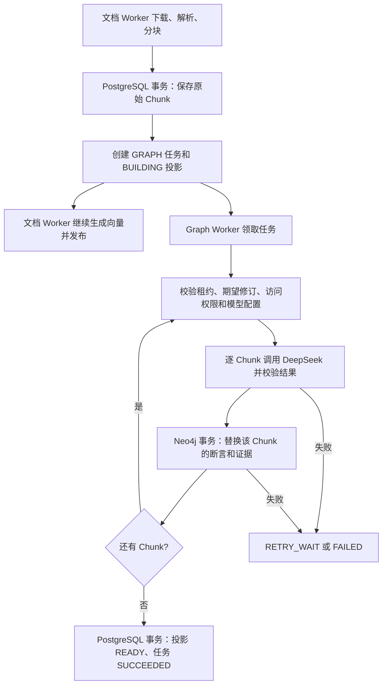

# 离线 Graph Worker 实现说明

选定文档的小范围版本重建、校验、切换与回退，见 [图谱重建操作说明](docs/GRAPH_REBUILD.md)。
以下主体保留初版 Worker 说明；当前抽取器预算与版本以源码和重建说明为准。

本文依据当前仓库的离线入库、Graph Worker 和补录代码，说明图谱任务如何产生、执行、落库及恢复。这里的“离线”指文档上传后的后台构建流程；图谱是可重建的 Neo4j 投影，任务和构建状态记录在 PostgreSQL。

## 1. 组件与职责

| 组件 | 代码位置 | 职责 |
| --- | --- | --- |
| 文档入库 Worker | `src/zhiqing_rag/workers/ingestion.py`、`publication.py` | 解析并暂存原始 Chunk，在同一 PostgreSQL 事务中创建 `GRAPH` 任务和投影记录；随后继续生成向量并发布文档。 |
| Graph Worker | `src/zhiqing_rag/workers/graph.py` | 独立轮询图任务，维持租约，逐块抽取、写入、汇总并结束任务。 |
| 图任务队列 | `src/zhiqing_rag/workers/graph_queue.py` | PostgreSQL 任务领取、心跳、范围校验、进度、完成与失败重试。 |
| 图谱抽取 | `src/zhiqing_rag/workers/graph_extraction.py` | 调用 DeepSeek JSON 模式，校验实体、关系、端点及逐字证据。 |
| Neo4j 投影 | `src/zhiqing_rag/workers/graph_storage.py` | 生成稳定键，并按 Chunk 事务化地替换实体证据和关系断言。 |
| 历史补录 | `src/zhiqing_rag/workers/backfill_graph.py` | 给已有、当前活动且已发布的索引批次补建图任务，也可立即运行或显式重试失败任务。 |

相关持久化模型为 `background_task`、`task_attempt`、`graph_projection` 和 `document_chunk`。任务 payload 的 `pipeline` 固定为 `document-graph-v1`，投影版本为 `1`，抽取规则版本为 `graph-extractor-v1`。

## 2. 端到端流程



1. `IngestionWorker.pipeline()` 解析原文件并得到 Chunk 后，调用 `stage_chunks_for_graph()`。它校验文档入库任务的有效租约、当前期望修订和上传者访问权限；在同一 PostgreSQL 事务内调用 `save_raw_chunks()`，创建 `GRAPH` 类型的 `background_task` 与状态为 `BUILDING` 的 `graph_projection`。幂等键为 `graph:{generation_id}:v1`。
2. 事务提交后，Graph Worker 可以读取尚未生成向量的 Chunk。文档 Worker 同时继续向量化；只有向量完整性校验通过，文档才切换活动索引批次并发布。图任务成功或失败均不决定文档发布，向量任务失败也不会自动取消已建的图任务。
3. Graph Worker 启动时验证 `NEO4J_ENABLED` 与 `DEEPSEEK_API_KEY`，连接 Neo4j 并创建键唯一约束、证据定位索引，然后循环领取任务。它只领取 `GRAPH` 且 payload 匹配 `document-graph-v1` 的待执行任务，或租约已过期的运行中任务。
4. 每次领取形成一个含任务、租户、文档、修订、批次、Worker 标识及租约代次的 `GraphLease`。处理前、每个 Chunk 前和模型调用后再次校验范围；随后读取 `document_chunk.content`，调用模型抽取并写入 Neo4j。每完成一块更新进度，最高到 99%；全部完成后将投影置为 `READY`、任务置为 `SUCCEEDED`，进度置为 100%。

## 3. 任务队列、租约和状态

领取采用 PostgreSQL 行锁 `FOR UPDATE SKIP LOCKED`，按 `next_run_at, id` 排序，使多个独立进程不会同时领取同一行。任务从 `PENDING`／`RETRY_WAIT` 进入 `RUNNING`；已运行任务租约到期后也可重新领取。重领时，旧的运行中 `task_attempt` 标记为 `LOST`、错误码为 `LEASE_EXPIRED`，新尝试递增 `attempt_count` 与 `lease_epoch`。

Graph Worker 每隔 `GRAPH_LEASE_SECONDS / 3` 续约一次。队列的心跳、读取范围、完成和失败操作均以任务状态、持有者、代次和未到期时间校验租约。失去租约的 Worker 不应再提交任务完成状态；提交前还会再次检查数据库时间。`task_attempt` 保留每次尝试的状态，成功时记录实体和关系数量。

范围校验还要求文档未删除、状态为 `DRAFT` 或 `PUBLISHED`、`desired_revision_id` 与任务修订一致，并复用文档发布阶段的 `verify_access()` 检查租户、成员、保密级别、知识库及写入授权。投影记录必须存在，且记录的模型名和 `GRAPH_NAMESPACE` 与当前 Worker 配置一致。Chunk 按同一租户和 `generation_id`、从 0 开始的 `chunk_index` 读取。

失败处理如下：

| 情况 | 处理 |
| --- | --- |
| DeepSeek 认证、权限或错误请求 | `MODEL_CONFIGURATION_ERROR`，直接失败。 |
| 修订失效、模型／命名空间变化、访问权限被撤销 | 对应错误码，直接失败。 |
| 模型输出连续三次为空、截断、Schema 或证据不合法 | `GRAPH_OUTPUT_EMPTY`、`GRAPH_OUTPUT_TRUNCATED`、`GRAPH_SCHEMA_INVALID` 或 `GRAPH_EVIDENCE_INVALID`；在任务层按可重试错误处理。 |
| 其他处理异常 | `GRAPH_PROCESSING_FAILED`，在剩余尝试次数内重试。 |
| 尝试次数耗尽 | `FAILED`，投影同步标记 `FAILED`。 |

可重试任务进入 `RETRY_WAIT`，退避秒数为 `min(300, 15 × 2^(attempt_count-1))`；默认最多尝试 3 次。终态错误写入任务及投影的 `error_code`，任务表不保存文档正文或模型凭据。

## 4. DeepSeek 抽取与校验

每个 Chunk 单独调用 OpenAI 兼容的异步客户端，使用 `DEEPSEEK_BASE_URL`、`GRAPH_EXTRACTION_MODEL`，`temperature=0`、`response_format={"type":"json_object"}`、关闭 thinking、`max_tokens=4096`，客户端内部自动重试设为 0。单次请求超时由 `GRAPH_LLM_TIMEOUT_SECONDS` 控制。模型输出最多尝试三轮；输出为空、截断或校验失败时，将错误反馈给模型重新生成完整 JSON。

输出必须是仅含 `entities`、`relations` 的对象。实体字段为局部 `id`、`type`、`name`、`canonical_name`、`evidence_quote`；关系字段为 `type`、`source_id`、`target_id`、`evidence_quote`、可空的 `condition_text`。Pydantic 禁止多余字段，限制字符串长度和列表大小（实体最多 80、关系最多 120）。提示词进一步要求每块最多抽 25 个实体、40 条关系。

实体类型白名单：`Actor`、`Process`、`Step`、`Material`、`Resource`、`Rule`、`State`、`Field`。关系类型及端点组合定义在 `ENDPOINTS`，包括流程步骤、责任、审核、材料、状态、规则、依赖和状态转换等 15 类；关系只能引用当前输出中实际存在的实体局部 ID。若模型仅将部分关系端点配错，代码可丢弃这些无效关系并保留其余通过验证的事实。

证据校验是逐字匹配：实体和关系的 `evidence_quote`、非空 `condition_text`、实体 `name` 必须出现在当前 Chunk 的正文中；`canonical_name` 要么也出现在正文中，要么与 `name` 仅有确定性的归一化差异。无法准确抽取时允许返回空的实体和关系列表。

## 5. Neo4j 数据结构与幂等写入

Neo4j 使用三类节点和四类边：

```text
(Entity)-[:MENTIONED_IN]->(Evidence)
(Assertion)-[:SUBJECT]->(Entity)
(Assertion)-[:OBJECT]->(Entity)
(Assertion)-[:SUPPORTED_BY]->(Evidence)
```

`Assertion.predicate` 保存关系类型，`condition_text` 保存原文条件。`Evidence` 保存命名空间、租户、知识库、文档、修订、索引批次、Chunk ID 与序号、正文 SHA-256、原文引句及块内起止位置，并保留页码、章节、Chunk 起止偏移和 `source_refs_json`。关系被建模为断言节点，便于将每条事实与具体证据关联。

实体名称做 Unicode NFKC、大小写折叠、连续空白合并和有限标点修剪。稳定键以规范化结果的 JSON 表示计算 SHA-256：实体键包含命名空间、租户、知识库、类型和规范名；`Step`、`State`、`Field`、`Rule` 额外包含文档 ID 与章节，减少跨上下文误合并。证据键包含命名空间、租户、批次、Chunk ID、引句在块内的位置和引句文本；断言键包含证据键、源实体键、关系类型、目标实体键和条件文本。

`GraphStore.prepare()` 为三类节点的 `key` 建唯一约束，并为 `Evidence(namespace, tenant_id, generation_id, chunk_id)` 建索引。写入单个 Chunk 时，先在同一 Neo4j 写事务内删除该 Chunk 旧证据关联的断言及旧证据，再用 `MERGE` 写实体、证据、断言和边。因此任务重试可重放，模型重抽导致的旧事实不会留在该 Chunk 的断言中。Worker 将本次处理返回的实体键、断言键在内存中去重，成功时把数量写入 `graph_projection`。

## 6. 运行与历史补录

先配置 `.env` 中的 `NEO4J_ENABLED=true`、`NEO4J_URI`、`NEO4J_USERNAME`、`NEO4J_PASSWORD`、`NEO4J_DATABASE`、`DEEPSEEK_API_KEY`，按需设置 `GRAPH_NAMESPACE`、`GRAPH_EXTRACTION_MODEL`、轮询间隔、租约、尝试次数和模型超时。默认轮询间隔为 2 秒，租约为 120 秒，最大尝试次数为 3，单次模型请求超时为 60 秒。

```powershell
uv run python -m zhiqing_rag.workers.graph
uv run python -m zhiqing_rag.workers.graph --once --task-id 123
```

`--once` 只领取并处理一个任务；`--task-id` 必须与 `--once` 同用。`start-dev.ps1` 在启用 Neo4j 时也会单独启动 Graph Worker 窗口。

历史数据使用补录程序。它只扫描当前活动批次、文档已发布、索引批次 `READY` 且有 Chunk 的记录；只有任务和投影都不存在时才在同一事务中补建。已有失败任务不会自动重建，须显式指定 `--retry-failed`，并满足当前批次、修订、权限、模型和命名空间校验。

```powershell
uv run python scripts/backfill_graph.py --dry-run
uv run python scripts/backfill_graph.py --run --workers 2
uv run python scripts/backfill_graph.py --tenant-id 1 --kb-id 2 --limit 10 --retry-failed --run
```

不加 `--run` 时只持久化新任务，交给独立 Graph Worker 处理。`--run` 会在补录进程内启动指定数量的 Worker 处理选中任务；可用 `--document-id` 缩小范围，用 `--task-timeout` 设置单任务等待上限。

## 7. 一致性与使用边界

- PostgreSQL 任务状态与 Neo4j 图写入属于两个数据库事务。若图已写入而 PostgreSQL 尚未成功提交 `READY`，后续重试会按 Chunk 重放；读取图谱时应以 PostgreSQL 当前文档、活动批次、投影状态和授权范围作为准入条件。
- 范围校验针对文档的期望修订；图任务可能针对尚未发布的批次执行。只有向量发布完成后，该批次才成为文档活动批次。旧批次的图数据也可能保留在 Neo4j 中，不能只凭节点存在就认为可用于查询。
- 重放会替换 Chunk 的断言和证据，稳定的共享实体节点不会被清理；当前实现没有图节点垃圾回收流程。
- 现有实现覆盖离线构建和状态记录。图谱检索与问答接入仍需在读取端实现，并执行租户、知识库、活动批次和访问权限过滤。

## 8. 代码验证入口

`tests/test_graph_worker.py` 覆盖结构及证据校验、模型 JSON 输出重试、稳定键与可重放写入；`tests/test_graph_worker_integration.py` 在显式设置 `RUN_GRAPH_INTEGRATION=1` 时验证真实 Neo4j 的重放、证据和空结果替换。后者默认跳过，需要可用的 Neo4j 环境。
